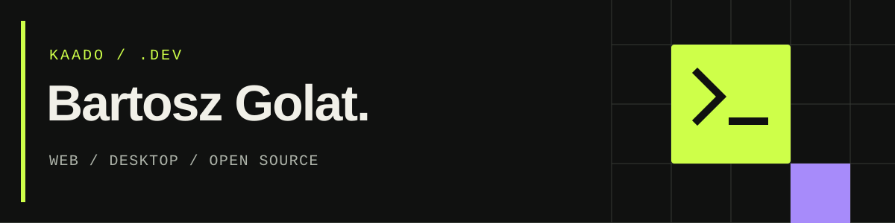

[English version](README.en.md)

# Cześć, jestem Bartosz.

W sieci używam pseudonimu **Kaado**. Tworzę strony internetowe, aplikacje i narzędzia, które rozwiązują konkretne problemy.

Pracuję w **Bee On Top**, a równolegle rozwijam własne projekty.

**[Portfolio](https://kaadeusz.pl)** · **[Narzędzia w przeglądarce](https://tools.kaadeusz.pl/pl/)** · **[Bee On Top](https://beeontop.com)** · **[LinkedIn](https://www.linkedin.com/in/bartosz-golat/)**

## Z czym pracuję

**Web:** TypeScript, React, Next.js, Node.js, PHP, Laravel, WordPress.

**Desktop i modele lokalne:** Python, PyQt, PyTorch.

## Projekty

### Biblioteki

- [ip-utils](https://github.com/K44DEUSZ/ip-utils)
- [password-generator](https://github.com/K44DEUSZ/password-generator)
- [number-utils](https://github.com/K44DEUSZ/number-utils)
- [color-utils](https://github.com/K44DEUSZ/color-utils)
- [favicon-generator](https://github.com/K44DEUSZ/favicon-generator)
- [image-utils](https://github.com/K44DEUSZ/image-utils)

### Aplikacje

- [PySkryptor](https://github.com/K44DEUSZ/PySkryptor)

### Serwisy

- [kaadeusz.pl](https://kaadeusz.pl)
- [Narzędzia w przeglądarce](https://tools.kaadeusz.pl/pl/)

## Porozmawiajmy

Masz pomysł na stronę, aplikację albo narzędzie? Napisz na **[kontakt@kaadeusz.pl](mailto:kontakt@kaadeusz.pl)**.
